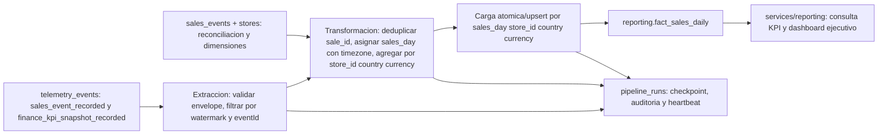

# Diseno: pipeline de desempeño de negocio Brasaland

**Fase:** diseno, sin codigo de orquestacion  
**Audiencia:** Direccion Ejecutiva (Mariana Restrepo), Finanzas y Operaciones  
**Estado del contrato:** pendiente confirmar el contexto especifico de data pipelines ausente de este checkout.

## Estado Actual (Current State)

El contexto general describe una cadena de 14 restaurantes en Colombia y Florida, con ventas en COP y USD, POS heterogeneos y reportes ejecutivos manuales. El contrato de telemetria define el evento `sales_event_recorded`, cuya carga contiene `sale_id`, `store_id`, `country`, `sold_at`, `total_amount`, `currency` y `timezone`. Define tambien `finance_kpi_snapshot_recorded` con `sales_count`, `total_sales`, `average_ticket` y `estimated_gross_margin_pct`.

En el estado de este checkout, la API persiste telemetria operativa en `store_telemetry_events` (estado POS, ventas de los ultimos cinco minutos, tickets abiertos, preparacion y RTT), y persiste ventas de dominio en `sales_events`. No se encontro una tabla `telemetry_events`, el modulo `services/telemetry/analysis.py` ni `GET /telemetry/report`. El endpoint de captura existente es `POST /api/v1/telemetry/events`; no se modificara como parte de este diseno. Esta diferencia con el estado previo supuesto por el reto debe resolverse al integrar los cambios, no ocultarse con una fuente inventada.

La arquitectura ya nombra el dataset `fact_sales_daily`, y existe `data/process/brasaland-marts/fact_sales_daily.csv` con grano diario y las columnas `sales_day`, `store_id`, `country`, `tickets`, `total_sales_native` y `currency`. Existe tambien `workflows/scripts/weekly_executive_report.py`, que consulta la API para generar un reporte semanal. Ninguno de estos elementos equivale al pipeline nuevo ni a una tabla persistida bajo `reporting`.

El reporte tecnico de telemetria descrito por el encargo responde volumen, errores y latencia para ingenieria. No responde de forma auditable cuanto vendio cada local/mercado en cada moneda, cual fue el ticket promedio ni cual fue el margen estimado; tampoco materializa el dataset para un dashboard ejecutivo. El script semanal actual consume la API y produce un archivo; este pipeline no lo reemplaza y no cambia su funcionamiento.

## Contrato de negocio

**Proposito:** materializar el consolidado semanal que alimenta el reporte ejecutivo de Mariana Restrepo cada lunes a las 07:00, calculando ventas por local, pais y moneda, ventas de cadena en COP/USD, ticket promedio y margen bruto estimado a partir de `sales_event_recorded` y `finance_kpi_snapshot_recorded`.

KPIs y reglas de calculo:

| KPI | Regla / dimensiones | Fuente de telemetria |
|---|---|---|
| Ventas diarias y semanales | Suma de `total_amount`, por `store_id`, `country`, periodo y `currency`; el dia de negocio se obtiene con `timezone`. Nunca sumar monedas nativas distintas. | `sales_event_recorded` |
| Ventas de cadena en COP y USD | Suma por moneda objetivo con tasa de cambio aprobada y versionada. Mantener tambien moneda y total nativos; no convertir silenciosamente. | `sales_event_recorded`; `fx_rate_version` si se convierte |
| Ticket promedio | `total_sales / sales_count` para el mismo periodo, local/mercado y moneda; devolver cero solo con `sales_count = 0`. | `finance_kpi_snapshot_recorded` (o ventas deduplicadas para el mismo grano) |
| Margen bruto estimado | Promedio ponderado por ventas de `estimated_gross_margin_pct`, solo cuando exista snapshot valido; etiquetarlo siempre como estimado, nunca contable. | `finance_kpi_snapshot_recorded` |

La fuente de verdad para el entregable semanal es el consolidado de negocio de estos eventos, no las metricas de salud de `store_telemetry_events`. `sales_events` puede usarse para reconciliar conteos e importes de dominio, no como sustituto silencioso de la fuente requerida. La ausencia de eventos no significa ventas cero si falta heartbeat/cobertura confirmada.

**Frecuencia y frescura:** ejecucion programada diaria para mantener dias reabribles y publicacion del consolidado semanal los lunes a las 07:00, hora de negocio configurada (zona de Direccion); objetivo de disponibilidad del conjunto semanal antes de las 07:00. Actualizaciones tardias recalculan el periodo afectado. Los periodos y fechas se guardan en UTC y se derivan por `timezone` IANA del local para cortes diarios.

## Extraccion y modelo de datos

- **Fuente principal:** `telemetry_events`, leyendo eventos `sales_event_recorded` y `finance_kpi_snapshot_recorded`; formato envelope versionado JSON, con `eventId` UUID, `timestamp` UTC, `event_type`, `schemaVersion`, `requestId` y `properties` validado contra `docs/telemetry/event-schemas.json`.
- **Cadencia de lectura:** cada ejecucion toma el watermark persistido y relee una ventana de dias recientes para aceptar eventos tardios. Paginar por clave estable y registrar limites de intervalo, no por offset mutable.
- **Fuente secundaria de reconciliacion:** `sales_events` y `stores` para comparar ventas/eventos, validar `store_id`, `country` y zona. Diferencias producen alerta y no se corrigen inventando ventas.
- **Extension de captura:** no se requiere un campo adicional para los KPI declarados: el evento financiero ya contiene `estimated_gross_margin_pct` y `fx_rate_version` es opcional. Si el contrato posterior exige coste, agregarlo solo al allowlist y payload del tipo existente que corresponda; no cambiar el envelope ni el reporte tecnico.
- **Destino propuesto:** `reporting.fact_sales_daily`, con grano `(sales_day, store_id, country, currency)`. Campos de negocio: `sales_day`, `store_id`, `country`, `currency`, `tickets`, `total_sales_native`, `average_ticket`, `estimated_gross_margin_pct`, `fx_rate_version`, `source_event_count`, `source_max_timestamp`, `updated_at` y `last_run_id`. El nombre reutiliza el dataset real `fact_sales_daily`, pero su creacion bajo `reporting` es nueva.

**Bloqueo de contrato:** el archivo indicado en el reto como `CONTEXT-company.md` y su seccion `Destination table` no estan en este checkout; tampoco hay seccion `KPIs a medir`. Por eso `reporting.fact_sales_daily` y el conjunto KPI anterior son una propuesta fundamentada en `CONTEXT.md`, `telemetry-plan.md` y la arquitectura local, no una afirmacion de que coinciden con un nombre externo ausente. Antes de implementar, confirmar el nombre literal y cualquier KPI/frecuencia adicional con ese contexto. No crear `reporting.business_metrics` ni desplegar la tabla propuesta como contrato definitivo sin esa confirmacion.

## Flujo

Las etapas de extraccion, transformacion y carga tienen entradas/salidas tipadas y conteos propios. La capa `services/reporting/` solo autentica, valida filtros y llama funciones/flows de `data/pipelines/`; no contiene SQL de agregacion ni logica ETL. No se escribe ningun resultado en `telemetry_events`.

## Duplicados, actualizaciones e idempotencia

1. **Reintento de captura:** deduplicar eventos en la ingesta con `eventId` como clave unica. Un reenvio con el mismo `eventId` y distinto timestamp de recepcion hace upsert/no-op del mismo evento, conservando el `timestamp` de ocurrencia y metadatos de recepcion. `requestId` sirve para correlacion, no para deduplicar.
2. **Misma venta emitida mas de una vez:** durante transformacion aplicar unicidad de negocio por `properties.sale_id` (ademas del `eventId`). Si dos IDs de evento representan la misma venta, contar una venta y enviar la colision a auditoria; no sumar dos veces. La ingesta idempotente y el agregado protegen capas distintas.
3. **Reintento parcial de carga:** calcular primero el conjunto completo de claves diarias afectadas en staging asociado a `run_id`. Validar conteos y restricciones y luego hacer upsert transaccional en destino por `(sales_day, store_id, country, currency)`. Repetir una particion reemplaza sus valores calculados, no incrementa acumuladores. En una base sin transaccion multi-fila, cargar una version staging y cambiar atomicamente el puntero/version publicada. Solo marcar particion completa despues del commit.
4. **Evento tardio:** cada corrida vuelve a leer una ventana movil de siete dias y cualquier particion indicada por eventos fuera de ventana. Recalcular y reemplazar la particion diaria completa desde la fuente deduplicada; registrar `late_event_reprocess`, fechas afectadas, conteos y corrida que invalida/publica. El historico de corridas no se sobreescribe.
5. **Reanudacion/checkpoint:** `pipeline_runs` persiste `run_id`, `phase`, watermark inicial/final y particiones completadas. Si la base cae durante carga, repetir staging/carga de particiones no confirmadas; las ya confirmadas se upsertean deterministicamente. Avanzar watermark solo despues de confirmar todas las particiones de ese intervalo.
6. **Concurrencia:** un lock unico por pipeline y ventana/particion evita solapamiento del cron con un disparo manual. Cada intento recibe UUID `run_id`; si existe ejecucion activa, responder conflicto con su identificador, no iniciar una segunda carga. Los locks expiran con lease y heartbeat y se liberan al completar/fallar.

## Observabilidad y recuperacion

Cada registro de `pipeline_runs` incluye al menos:

| Campo | Proposito de auditoria |
|---|---|
| `run_id`, `flow_name`, `trigger`, `code_version` | Identificar ejecucion, flow, cron/manual y version reproducible. |
| `started_at`, `finished_at`, `status`, `phase` | Duracion, resultado y etapa/checkpoint donde se detuvo. |
| `window_start`, `window_end`, `watermark_start`, `watermark_end` | Reconstruir intervalo procesado y progreso seguro. |
| `source_rows_read`, `events_valid`, `events_deduplicated`, `sales_unique`, `rows_written`, `partitions_completed` | Detectar huecos, duplicados, cambios de volumen y carga parcial. |
| `late_events`, `reconciliation_mismatches` | Identificar recalculos y divergencias contra `sales_events`. |
| `error_code`, `error_message_redacted`, `retry_count` | Diagnosticar y reintentar sin filtrar secretos o payload sensible. |
| `heartbeat_at`, `request_id`, `source_max_timestamp` | Distinguir ausencia real de eventos de productor silencioso, correlacionar la ruta y medir atraso. |

Estados minimos: `Running`, `Completed`, `Failed`; se recomienda `Retrying` y `Cancelled` para distinguir recuperacion y cancelacion. Cero ventas solo se publica para un local/periodo con cobertura de captura saludable. Heartbeat por fuente/local, freshness del ultimo `timestamp`, volumen contra locales activos y alertas por silencio detectan fallas de captura; picos se comparan con ventas canonicas y eventos deduplicados para separar batch tardio de crecimiento real. Correlacionar `requestId` de evento y `run_id` desde extraccion hasta destino.

Los fallos transitorios de red/base reintentan con backoff limitado; errores de esquema quedan en cuarentena redacted y fallan la particion afectada sin avanzar watermark. El siguiente run retoma desde el ultimo checkpoint confirmado. La alerta operativa incluye `run_id`, fase, intervalo, fuente y accion de recuperacion. El dashboard debe mostrar freshness/estado, no presentar como cero un KPI sin dato fresco.

Un buffer offline de cliente queda fuera de este pipeline: el productor puede reintentar con `Idempotency-Key` basado en `eventId`; el servidor devuelve exito/idempotent replay si ya existe y reintento solo en errores transitorios. La deduplicacion autoritativa es servidor-side. No se aceptan secretos ni payloads completos en logs.

## Orquestacion Prefect

- **Flow principal:** `business_performance_flow(window_start, window_end, trigger)` coordina lock, checkpoint, tareas y publicacion. El schedule ejecuta el cierre semanal el lunes a las 07:00 y una corrida diaria de refresco; disparo manual usa el mismo flow y validaciones.
- **Tasks:** `extract_telemetry_events` lee/pagina y valida envelope; `transform_sales_metrics` deduplica por `eventId`/`sale_id`, enriquece local y calcula KPIs; `load_reporting_partitions` valida y hace upsert transaccional; `reconcile_sales_source` compara con `sales_events`; `record_run_checkpoint` persiste fase, heartbeat y resultado.
- **States:** `Running` al adquirir lock; `Completed` solo tras carga y checkpoint confirmados; `Failed` ante error no recuperable sin avanzar watermark. Los reintentos de task deben ser seguros por las claves idempotentes.
- **Blocks:** bloque de conexion a base/warehouse (credenciales Supabase si ese es el destino real), `Secret` para credenciales, bloque de almacenamiento/configuracion de tasa FX versionada y bloque de notificaciones. Ninguna credencial vive en codigo, documento de run ni respuesta del API.
- **Flows secundarios:** no necesarios para la primera version. Un futuro backfill podria invocar las mismas tasks por rango, conservando el mismo upsert y auditoria.

## API nueva de reporting (diseno)

Modulo nuevo `services/reporting/`, con autorizacion ejecutiva y de servicio, separado de `services/telemetry/` y sin cambiar `GET /telemetry/report` ni `POST /api/v1/telemetry/events`.

| Endpoint propuesto | Uso y respuesta | Funcion/flow llamado |
|---|---|---|
| `GET /api/v1/reporting/status` | Estado ultimo run, `run_id`, fase, heartbeat, freshness y particiones; diferencia `Completed` de ausencia de captura. | `get_business_performance_status()` en `data/pipelines/`. |
| `POST /api/v1/reporting/runs` | Disparo manual con ventana opcional e idempotency key; devuelve `202` y `run_id`, o `409` con ejecucion activa para la ventana. | `business_performance_flow(...)` en `data/pipelines/`. |
| `GET /api/v1/reporting/kpis` | Feed de dashboard: periodo, `store_id`, `country`, `currency`, ventas, tickets, ticket promedio, margen estimado, freshness y `last_run_id`; filtros de fechas/local/pais/moneda. | `query_business_kpis(...)` en `data/pipelines/` (lectura de `reporting.fact_sales_daily`, sin ETL en servicio). |

Los paths son propuesta de API y se deben versionar/revisar junto al contrato de la tabla. Ningun endpoint de reporting escribe en telemetria ni invoca el reporte tecnico.

## Pendientes antes de implementacion

1. Incorporar o entregar el `CONTEXT-company.md` de data pipelines y confirmar literalmente `Destination table`, KPIs obligatorios, audiencia, zona horaria y cadencia. Sin el, el nombre `reporting.fact_sales_daily` sigue siendo propuesta, no contrato aprobado.
2. Resolver la diferencia entre el reto y este checkout: incorporar la fuente contractual `telemetry_events`/eventos de negocio y el reporte tecnico previo solo si pertenecen a la rama correcta; preservar cualquier `services/telemetry/analysis.py` y `GET /telemetry/report` existente sin modificarlos.
3. Acordar conversion COP/USD, proveedor/version y fecha efectiva de FX, definicion de margen estimado, cobertura de heartbeat y politica de cierre/reapertura semanal con Finanzas y Operaciones.
4. Definir motor/warehouse destino y soporte de transacciones o staging con swap atomico; crear esquema `reporting`, tabla aprobada, tabla `pipeline_runs`, permisos, retencion y alertas.